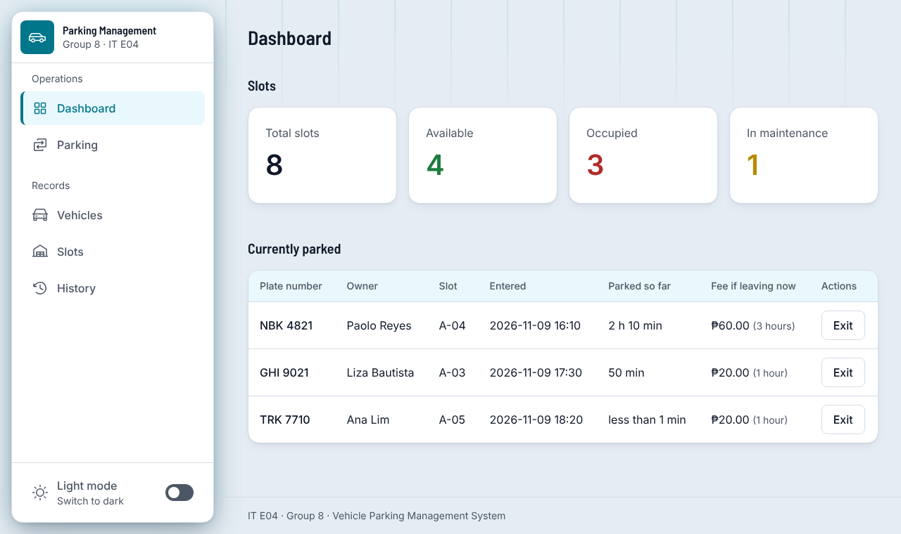
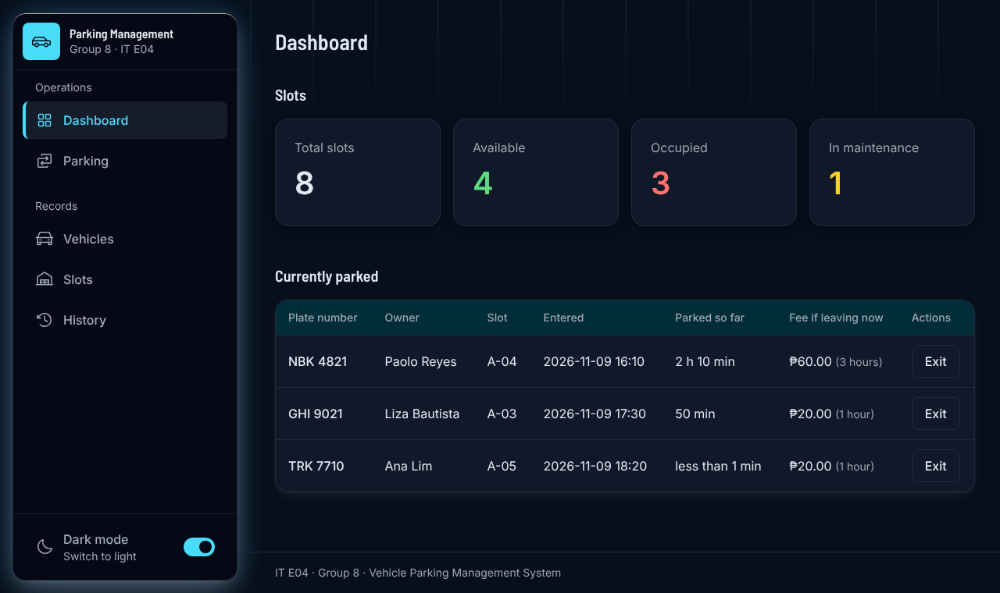
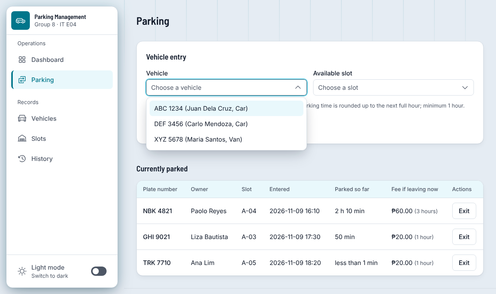
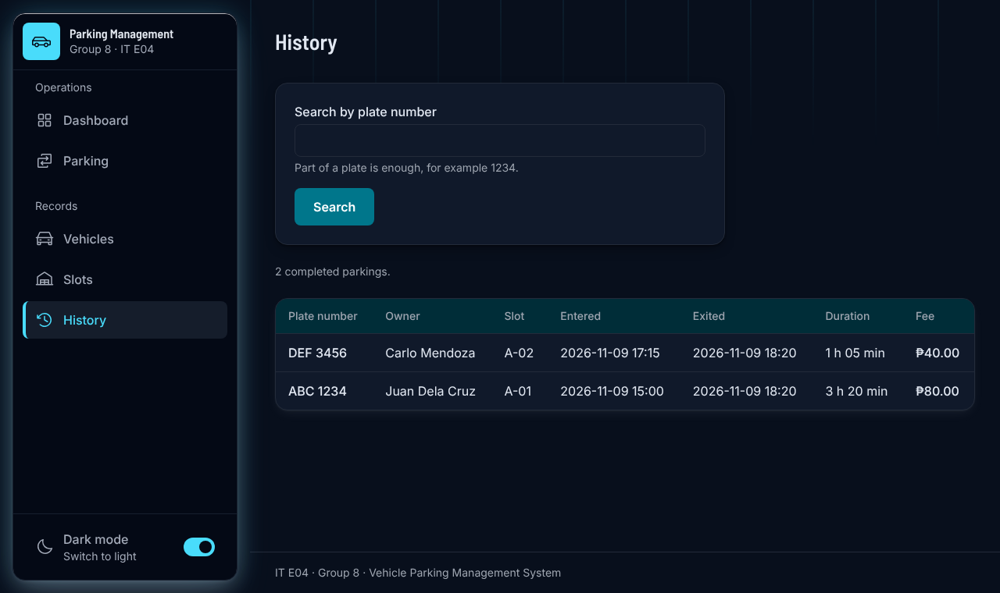
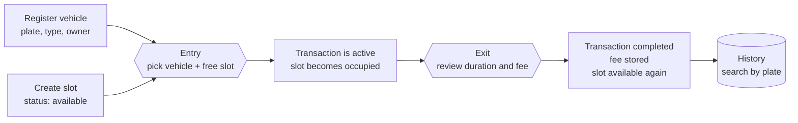
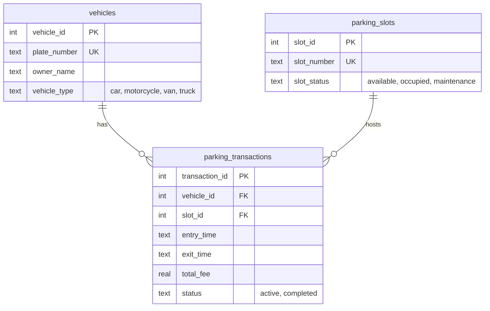

<!-- Parking Management System · README -->

<div align="center">


<br>


</div>

---

## About the Project

**Vehicle Parking Management System** is a web application for running a small parking lot. Staff register vehicles, manage parking slots, record when a vehicle enters and leaves, and the system works out the parking fee and keeps every slot's availability accurate.

It is the group project for **IT E04 – Integrative Programming and Technologies 2** (Group 8, 3rd Year BSIT). The brief asks for a system that **prevents conflicting active reservations** and **keeps slot availability accurate**, so the rules that guarantee this live in both Python and the database.

- **Register** vehicles (plate number, vehicle type, owner name) and **manage** parking slots (create, edit, view, set to maintenance).
- **Park a vehicle**: pick a vehicle that is not parked and a slot that is free. The entry time is recorded by the server.
- **Exit a vehicle**: see the duration and fee first, then confirm. The slot is released in the same step.
- **Dashboard** with total, available, occupied and in-maintenance slot counts, and everyone currently parked.
- **Search and history**: find completed parkings by (part of) a plate number.
- **Fees** from parking duration and one stated hourly rate.
- Light and dark theme, responsive from phone to desktop.

> Use fictional data only. The app has no sign-in: anyone who can open the page can use it. It is built for a classroom demo, not for real vehicle records.

---

## Screenshots

<div align="center">

|                                                Light                                                |                                           Dark                                            |
| :-------------------------------------------------------------------------------------------------: | :---------------------------------------------------------------------------------------: |
|                |        |
|                            **Dashboard**: slot counts and who is parked                             |                                **Dashboard** in dark mode                                 |
|  |  |
|                             **Vehicle entry** with the styled dropdown                              |                               **History** with plate search                               |

</div>

---

## How It Works

### A parking visit



1. **Entry** (`/parking`): choose a vehicle that is not parked and a slot that is available. In **one database transaction** the app inserts an `active` parking record with the current time and sets the slot to `occupied`.
2. **Exit** (`/parking/<id>/exit`): the page shows the time parked, the hours charged and the fee. When confirmed, **one database transaction** sets the exit time, stores the fee, marks the record `completed` and sets the slot back to `available`.
3. **History** (`/history`): completed records with entry, exit, duration and fee, newest first. Type part of a plate to search.

### Parking fee

One fixed rate of **₱20.00 per hour** for every vehicle type. The duration is rounded **up** to the next full hour, with a minimum of one hour:

```
hours_charged = max(MINIMUM_HOURS, ceil(parked_seconds / 3600))
total_fee     = hours_charged × HOURLY_RATE
```

| Parked for         | Hours charged | Fee at ₱20.00 |
| ------------------ | :-----------: | ------------: |
| 5 minutes          |       1       |        ₱20.00 |
| 1 hour exactly     |       1       |        ₱20.00 |
| 1 hour 1 minute    |       2       |        ₱40.00 |
| 2 hours 30 minutes |       3       |        ₱60.00 |
| 3 hours exactly    |       3       |        ₱60.00 |

The rate and the rule are shown on the entry and exit pages. The fee is calculated once, by `services/fees.py`, and stored; changing the rate later does not change past records.

### Business rules and where they are enforced

| Rule from the brief                             | Python                              | Database                                          |
| ----------------------------------------------- | ----------------------------------- | ------------------------------------------------- |
| Only one active transaction per slot            | checked before insert               | partial unique index on `slot_id` where active    |
| One active transaction per vehicle              | checked before insert               | partial unique index on `vehicle_id` where active |
| Exiting releases the slot                       | exit service                        | same database transaction                         |
| Fees calculated consistently with a stated rate | a single `calculate_fee()`          | fee stored in `total_fee`                         |
| Related updates are safe                        | `write_transaction()` with rollback | SQLite transaction (`BEGIN IMMEDIATE`)            |

Python gives friendly messages; the database constraints (`UNIQUE`, `CHECK`, foreign keys, partial indexes) are the safety net if anything slips past.

### Data model



---

## Pages

| Page      | Address              | What it does                                        |
| --------- | -------------------- | --------------------------------------------------- |
| Dashboard | `/`                  | Slot counts and the active parkings with Exit links |
| Parking   | `/parking`           | Vehicle entry form and the active parkings          |
| Exit      | `/parking/<id>/exit` | Duration and fee review, then confirm               |
| Vehicles  | `/vehicles`          | List, register (`/new`), edit, delete               |
| Slots     | `/slots`             | List, create (`/new`), edit, delete                 |
| History   | `/history?q=`        | Completed parkings, search by plate                 |

A vehicle or slot that has history, or is parked right now, cannot be deleted. State-changing actions are always `POST`.

---

## Tech Stack

| Layer                      | Used for                                                                          |
| -------------------------- | --------------------------------------------------------------------------------- |
| **Python 3 + Flask**       | Routes (blueprints), request handling, business logic                             |
| **Jinja templates + HTML** | The interface, shared macros (`_macros.html`)                                     |
| **Tailwind CSS v4**        | Styling with design tokens, light and dark theme                                  |
| **SQLite + SQL**           | Persistent records, parameterized queries only                                    |
| **Vanilla JavaScript**     | Theme switch, mobile sidebar, toast notifications, confirm dialog, dropdown menus |
| **unittest**               | 66 automated checks against the project brief                                     |

Fonts are self-hosted: Barlow Semi Condensed for headings, Inter for body text.

---

## Getting Started

### Prerequisites

- **Python 3.10 or newer**
- **Tailwind CSS v4 standalone CLI** (only to rebuild the styles; no Node needed). Download the binary for your system from the [Tailwind releases page](https://github.com/tailwindlabs/tailwindcss/releases) and put it in the project folder or on your `PATH`.
- A modern browser: Chrome 119+, Safari 16.4+ or Firefox 128+ (colours use OKLCH relative colour syntax).

### Installation

```bash
# 1. Open the project folder
cd parking_management_system

# 2. Create and activate a virtual environment
python -m venv .venv
.venv\Scripts\activate            # Windows
source .venv/bin/activate         # macOS / Linux

# 3. Install the dependency
pip install -r requirements.txt

# 4. Create the database (add --reset to delete all data first)
flask --app app init-db

# 5. Build the styles (the zip already includes a built app.css; it is not in Git)
tailwindcss -i static/src/tailwind.css -o static/css/app.css

# 6. Run (either command works)
flask --app app run --debug
python -m flask --app app run --debug
```

Open **http://127.0.0.1:5000**. While you edit templates or CSS, run step 5 with `--watch` in a second terminal so the styles rebuild by themselves.

### Try it in two minutes

1. **Slots** → _Add slot_: create `A-01` and `A-02`.
2. **Vehicles** → _Register vehicle_: add `ABC 1234`, any owner, type _Car_.
3. **Parking**: choose the vehicle and a slot, then _Enter_.
4. **Dashboard**: the slot now shows as occupied. Click _Exit_, review the fee, confirm.
5. **History**: search `1234` to find the completed parking.

### Run the tests

```bash
python -m unittest discover -s tests -v
```

The tests build a temporary database for each case, so your real data is never touched. They cover the seven required features, the three tables, the five business rules (including rollback and two simultaneous requests for one slot), parameterized queries, input validation, error pages and the notification, dialog and dropdown markup.

### Configuration

Everything lives in `config.py`.

| Setting           | Default                     | Meaning                                                                 |
| ----------------- | --------------------------- | ----------------------------------------------------------------------- |
| `HOURLY_RATE`     | `20.00`                     | Fixed rate in pesos per hour                                            |
| `MINIMUM_HOURS`   | `1`                         | Fewest hours ever charged                                               |
| `CURRENCY_SYMBOL` | `₱`                         | Shown next to every amount                                              |
| `VEHICLE_TYPES`   | car, motorcycle, van, truck | Must match the `CHECK` in `schema.sql`                                  |
| `SECRET_KEY`      | `dev-change-me`             | Set the `SECRET_KEY` environment variable for anything beyond local use |

---

## Project Structure

```
parking_management_system/
├── app.py                 app factory, dashboard route, error pages
├── config.py              rate, minimum hours, vehicle types, secret key
├── db.py                  connection, write_transaction(), init-db command
├── schema.sql             tables, constraints, partial unique indexes
├── requirements.txt
├── routes/                blueprints: parking, vehicles, slots, history
├── services/              business logic and SQL: fees, parking, history, vehicles, slots
├── templates/             Jinja pages, _macros.html, _sidebar.html
├── static/
│   ├── src/tailwind.css   design tokens and shared utilities
│   ├── css/app.css        built output (not in Git: build it before running)
│   ├── js/                app.js, toast.js, dropdown.js, sidebar.js, theme.js
│   └── fonts/             Barlow Semi Condensed, Inter
├── tests/                 test_project_spec.py
└── docs/assets/           banner and screenshots used by this README
```

---

## Team

**Group 8 · IT E04 · 3rd Year BSIT**

| Members                |
| ---------------------- |
| Dela Cruz, Arjay G.    |
| Dumay, Ayessa Mae V.   |
| Pile, Mark Lhester B.  |
| Valmadrid, Rain Janiel |

---

## Notes and Limits

- **No sign-in.** Anyone who can open the pages can change data. Do not use real vehicle or owner information.
- **Single lot, single rate.** One flat hourly rate applies to every vehicle type.
- **Times are local.** Entry and exit times are recorded by the server in its local time and are never typed in.
- **Turn debug off for the defense demo**: run `flask --app app run` without `--debug`.

<div align="center">
<sub>Built for IT E04 · Group 8 · Vehicle Parking Management System</sub>
</div>
